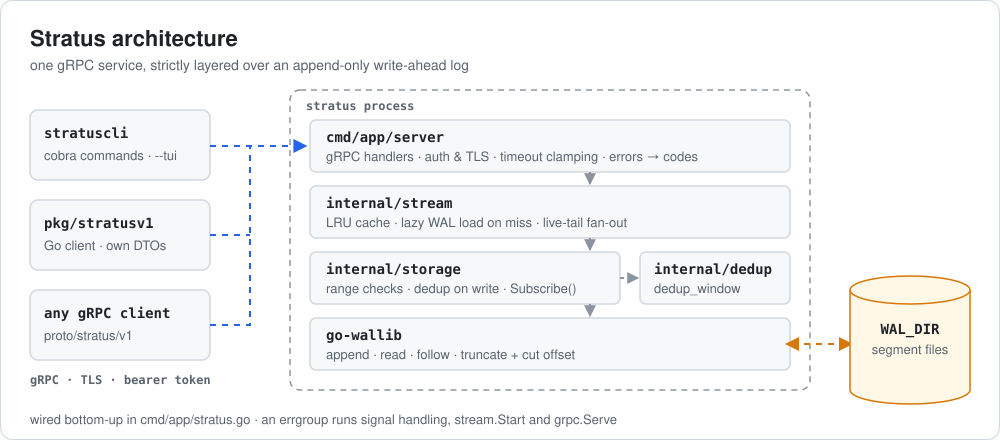

# Stratus

[](https://github.com/barnowlsnest/stratus/actions/workflows/docker.yml)
[](https://pkg.go.dev/github.com/barnowlsnest/stratus)
[](go.mod)
[](LICENSE)

**An append-only record stream served over gRPC, persisted in a write-ahead log.**

Records are appended with a client-supplied dedup key, assigned a monotonic ID (the WAL LSN),
and read back by ID — either as a bounded range or as a live tail that blocks until new records
arrive. A LRU cache in front of the WAL serves recent reads without touching the filesystem.



## Install

The server and CLI ship as container images on GHCR, tagged by release:

```sh
docker pull ghcr.io/barnowlsnest/stratus:<release>     # server
docker pull ghcr.io/barnowlsnest/stratuscli:<release>  # CLI
```

Each release also carries prebuilt `stratuscli` binaries for `linux-amd64`, `linux-arm64` and
`darwin-arm64` — grab one from the [releases page](https://github.com/barnowlsnest/stratus/releases).
With a Go toolchain, `go install github.com/barnowlsnest/stratus/cmd/cli@latest` works too, though
it names the binary `cli`; rename it if you want `stratuscli` on your `PATH`.

To talk to a server from your own Go code, take the client package only:

```sh
go get github.com/barnowlsnest/stratus
```

## Quick start

`wal_dir` is the only required setting. Run the server, then point the CLI at it:

```sh
mkdir -p /tmp/stratus-wal
WAL_DIR=/tmp/stratus-wal stratus          # or: task docker-run

stratuscli add -k 1 -d hello              # append one record
stratuscli get                            # read the whole stream
stratuscli info                           # range and record counts
stratuscli --tui                          # full-screen console
```

That runs unauthenticated and in plaintext on loopback — see [Security](#security) before exposing
it anywhere else.

## Concepts

- **Record ID** — the LSN the WAL assigns on append. IDs are monotonic and start at 1; `0` is
  never a valid record ID and is used as a "not set" sentinel in requests.
- **Dedup key** — a non-zero, client-generated `uint64`. A key seen again within the dedup window
  (`dedup_window`, default `1m`) causes the record to be dropped and counted as a duplicate.
- **Stream range** — the inclusive `[start, end]` window of IDs that can be read: from the WAL's
  first ID to the last ID the cache has received. `Delete` moves `start` forward; `Add` moves `end`
  forward.

## How it works

`Add` writes straight through to the WAL. A follower on the WAL then puts each new record into the
LRU cache and wakes any `ReadOffset` tails waiting for more; `Add` returns once its records are in
the cache. It caches every record already waiting (up to `subscriber_buffer`) before it wakes the
tails, so each tail sends them as one message instead of one message per record. Reads never go past the last record the cache has received, so a fresh record is always
served from the cache. At the first evicted record, the rest of the range is read from the WAL in one
pass. Those records are not cached, so a reader far behind cannot push the newest records, which the
tails read, out of the cache.



## Performance

CPU and memory depend on record size, batch size, how many tails are open and how much of the
reading stays inside the cache. Writes are bound by fsync, so the disk matters most for them.

### Sizing one server

RAM is mostly made of four parts:

- **Cache:** `cache_size` × record size.
- **Dedup keys:** every record's key is kept for `dedup_window` (default 1 min), so the key set
  grows with the write rate.
- **Follower queue:** up to `subscriber_buffer` (default 1024) waiting records, each with a copy of
  its payload. The newest `subscriber_buffer` records also stay referenced for tails, which only
  costs extra memory when `cache_size` is smaller.
- **Lagging tails:** each tail that is behind its reader holds one encoded message in gRPC's send
  buffers: 32 KB at the default `max_read_bytes`, 1 MB above it (see
  [Tail message size](#tail-message-size)).

Go's garbage collector can roughly double the live heap. Set `GOMEMLIMIT` to about 80% of the
memory you give the server.

### Limits

- **Single node.** One stream, one WAL and one server, with no replication, failover or sharding.
- **Record and response size.** gRPC's default 4 MiB receive limit caps a single `Add`, and also any
  `ReadRange` response that a default client receives. For example, 64 records of 64 KiB fail with
  `RESOURCE_EXHAUSTED`.
- **Writes are fsynced before `Add` returns.** Group commits hold up to `wal_batch_size` requests,
  so a client doing single-record `Add` calls is bound by fsync latency. Batch records.
- **`Add` returns once its records are in the cache**, so they are readable as soon as it returns.
- **Reads outside the cache go to the WAL.** A WAL reader starts near the requested ID through the
  WAL's in-memory segment index, so a read that misses the LRU reads from disk instead of memory
  but does not scan the whole segment. Size `cache_size` to cover how far behind readers and tails
  can fall.
- **Startup reads the newest `cache_size` records** of the WAL to warm the cache; with a
  `cache_size` of 0 it reads the whole WAL.
- **`ReadOffset`** sends at most `max_records` − 1 records per request, and its timeout must be
  between 61 ms and 24 h.
- **`Delete` cannot empty the stream:** the record at `end_id` stays.
- **`ReadOffset` messages are bounded:** each carries at most `max_batch_read_size` records and
  stops before the record that would take its encoded size past `max_read_bytes`, so a tail far
  behind catches up in steps. A single record larger than `max_read_bytes` is still sent, on its
  own. See [Tail message size](#tail-message-size) for the default.

### Scaling

Client side, which gives the biggest gains:

1. **Batch records in each `Add`.** Each call pays one fsync, so more records per call means more
   records per second.
2. **Share connections.** Run many `ReadOffset` streams over a few connections per client process.
   One connection per stream costs the server noticeably more CPU per record. A client not built
   with `stratusv1.Dial` should raise its flow-control windows (see below), which recovers most of
   that cost when it does open one connection per stream.
3. **Keep reads inside the cache.** Raise `cache_size` instead of reading old ranges.

Server side:

- **More cores help reads and tail fan-out.** Writes all go through one WAL writer and fsync, so
  extra cores don't raise single-record write throughput; batching does.
- **To go beyond one server**, run one stratus server per stream or partition and route keys to them
  on the client side. There are no built-in replicas.

Known limits in the code that would raise these ceilings:

- an index inside each WAL segment, for reads outside the cache;
- less locking in the LRU, which takes one exclusive lock per read of records older than the newest
  `subscriber_buffer`.

### Tail message size

`max_read_bytes` caps the encoded size of each `ReadOffset` message, counting every record as its
payload plus 20 bytes of protobuf overhead. Keep the default of 32,000.

gRPC encodes each outgoing message into a buffer from a pool of fixed sizes: 256 B, 4 KB, 16 KB,
32 KB and then 1 MB. A message up to 32 KiB gets a 32 KB buffer; anything larger, even slightly,
gets a 1 MB one. A tail that keeps up sends small messages and returns its buffer at once, but a tail
that is behind its reader holds a full message until the reader takes it. With many slow readers at
the same time, that is one buffer per tail, so a budget above 32 KiB multiplies tail memory by about 30.

Larger messages buy little in return: a tail sends the same records in fewer `Send` calls, which
saves a small share of CPU and throughput, and latency is no better. The cost of the default falls
on streams of large records, where tails lose batching: a record over about 16 KB goes in a message
of its own.

Raise `max_read_bytes` only when tails rarely fall behind and records are large; keep it under the
clients' gRPC receive limit (4 MiB by default).

### Production loadbench

`task loadbench` is a **manual production go/no-go gate**. It is not part of `task sanity`. It builds
the server, starts it with a temporary WAL and pprof on a free loopback port, drives fixed load
grades over the real gRPC client, samples **RSS / CPU / WAL disk**, captures CPU and heap profiles,
and writes a report under `dist/loadbench/`.

```sh
task loadbench
# smoke only, shorter grades (duration unit 1s → smoke is 15s):
task loadbench -- --grades smoke --duration 1s
# fail if RSS exceeds 50 MiB (useful to verify the gate):
task loadbench -- --grades smoke --max-rss 50MiB
```

Exit `0` is **GO**, exit `1` is **NO-GO**. Open `dist/loadbench/report.md` for the table of write/read
RPS, Add p99, peak RSS, CPU%, disk growth, and max tail lag. Profiles land in
`dist/loadbench/<grade>/cpu.pb.gz` and `heap.pb.gz`:

```sh
go tool pprof dist/loadbench/fanout_stress/cpu.pb.gz
go tool pprof dist/loadbench/lagging/heap.pb.gz
```

Grades: `smoke`, `write_heavy`, `fanout`, `fanout_stress` (512 tails), `lagging` (slow drains),
`catchup` (preload then tails from ID 1). Default fail thresholds: peak RSS above 2 GiB, `write_heavy`
below 500 records/s, `lagging` above 1 GiB RSS, unexpected RPC errors, unbounded lag on caught-up
grades, or a dead server / unreachable pprof.

## API

The service is `stratus.v1.StreamService`, defined in [`proto/stratus/v1/stratus.proto`](proto/stratus/v1/stratus.proto).

| RPC              | Kind          | Purpose                                                         |
|------------------|---------------|-----------------------------------------------------------------|
| `Add`            | unary         | Append a batch of records.                                      |
| `ReadRange`      | unary         | Read the inclusive ID range `[start_id, end_id]`.               |
| `ReadOffset`     | server stream | Read up to `max_records` from `start_id`, tailing for new ones. |
| `Delete`         | unary         | Drop records before `end_id`; the record at `end_id` stays.     |
| `ReconcileCache` | unary         | Rebuild the in-memory cache from the WAL.                       |
| `GetStreamInfo`  | unary         | Report the current range and record counts.                     |

### Add

Takes `repeated InputRecord records`, each with a non-zero `dedup_key` and non-empty `raw_data`.
Returns `added_records` (the IDs assigned to records that were written), `stream_records` (the
stream's range after the write), and `duplicate_records` (how many were dropped by the dedup
window). `Add` returns once its records are in the cache, so they can be read as soon as it
returns. If the caller's deadline expires or the server stops while `Add` waits for that, it still
returns the normal result: the records are already in the WAL.

An empty batch is `INVALID_ARGUMENT`. A batch where *every* record is a duplicate is
`ALREADY_EXISTS` — no partial result is returned. A batch that is partially duplicate succeeds,
and `added_records` covers only the records that made it in.

### ReadRange

Reads `[start_id, end_id]` inclusive. Either bound may be `0`, meaning "the stream's current
first / last ID", so `{}` reads the whole stream.

The range is clamped to the stream's window: a range that overlaps the window is trimmed to it,
while a range entirely outside it is `OUT_OF_RANGE`. Records are served from the LRU cache,
and from the first miss the rest of the range is read from the WAL in one pass and cached, so there is no
fixed per-request record cap.

`timeout` bounds the read on the server side; when unset or non-positive, the read is bounded
only by the caller's context.

### ReadOffset

Streams `ReadResponse` messages starting at `start_id` until `max_records` have been sent or the
timeout expires. Unlike `ReadRange`, it does not end at the current tail: when it catches up it
blocks until `Add` produces more records, then keeps sending. Records already deleted from under
the reader (`start_id` below the stream's first ID) end the stream with `OUT_OF_RANGE`.

The stream stops once its next ID reaches `start_id + max_records - 1`, so every request sends at most `max_records - 1` records; a `max_records` of `1` sends nothing. If it catches up with the current tail before reaching that limit, it waits for new records until the timeout or limit. To receive exactly `n` while tailing, ask for `n + 1` and stop after `n`.

`max_records` must be non-zero (`INVALID_ARGUMENT` otherwise). `timeout` is clamped to a floor of
61ms and must not exceed 24h. Timeout expiry is a normal end of stream, not an error.

### Delete

Removes every record before `end_id` and evicts them from the cache. The record at `end_id` stays
and becomes the stream's first record, so `Delete` cannot empty a stream. Returns `deleted_records`
and the remaining `stream_records`. An `end_id` of `0`, or one outside the current stream range, is
`OUT_OF_RANGE`. An `end_id` equal to the current first ID removes nothing and reports
`deleted_records` as `0-0`.

For example, on a stream of `1-20`, an `end_id` of `3` returns `deleted_records` `1-2` and
`stream_records` `3-20`.

Deletion truncates the WAL to `end_id` and then cuts it at that offset, so removal is exact rather
than segment-granular: `deleted_records` is the range that is really gone.

### ReconcileCache

Clears the cache and reloads it from the WAL over the stream's current range, then returns that
range. Useful after a `Delete` or when the cache has been churned by cold reads. The reload
reads only the newest `cache_size` records of the range (the whole range when `cache_size` is 0),
in one pass. The startup preload works the same way.

### GetStreamInfo

Returns the stream `range`, `cached_records` (entries currently in the LRU) and `fs_records`
(records in the WAL).

### Status codes

| Code                             | Cause                                                                        |
|----------------------------------|------------------------------------------------------------------------------|
| `INVALID_ARGUMENT`               | empty batch, empty record or dedup key, `max_records` of 0, timeout over 24h |
| `OUT_OF_RANGE`                   | requested range lies outside the stream window                               |
| `ALREADY_EXISTS`                 | every record in the batch was a duplicate                                    |
| `DEADLINE_EXCEEDED` / `CANCELED` | context expired or cancelled                                                 |
| `INTERNAL`                       | anything else (WAL failures)                                                 |

## Go client

`pkg/stratusv1` wraps the generated stubs with its own DTOs, so callers do not depend on the
protobuf package.

```go
tlsOpt, err := stratusv1.WithTLS("ca.pem") // "" verifies against system roots
if err != nil {
    return err
}

c, err := stratusv1.Dial("stratus.example:8000", tlsOpt, stratusv1.WithToken(os.Getenv("AUTH_TOKEN")))
if err != nil {
    return err
}
defer c.Close()

added, err := c.Add(ctx, []stratusv1.InputRecord{
    {DedupKey: 1, RawData: []byte("hello")},
})

// Bounded read.
records, err := c.ReadRange(ctx, added.AddedRecords.Start, added.AddedRecords.End, 0)

// Live tail: ReadOffset returns a channel closed when the stream ends.
ch, err := c.ReadOffset(ctx, 1, 100, 30*time.Second)
for r := range ch {
    fmt.Println(r.ID, string(r.RawData))
}
```

`Dial` gives the client ownership of the connection (`Close` shuts it down); `New` wraps a
connection you keep owning (`Close` is then a no-op). Against a loopback server without TLS, use
`stratusv1.WithInsecure()` instead of `WithTLS`.

`Dial` sets gRPC flow-control windows of 1 MiB per stream and 8 MiB per connection, so the server
sends tails fewer, larger writes. A reader that falls behind may buffer up to that much, and fixed
windows turn off gRPC's automatic window sizing. Pass `grpc.WithInitialWindowSize` or
`grpc.WithInitialConnWindowSize` to `Dial` to override them; `New` leaves the connection as you
built it.

## Configuration

Settings come from flags or environment variables of the same name (uppercased).

| Name                   | Default     | Meaning                                                                                                                    |
|------------------------|-------------|----------------------------------------------------------------------------------------------------------------------------|
| `host`                 | `127.0.0.1` | listen host                                                                                                                |
| `port`                 | `8000`      | listen port                                                                                                                |
| `wal_dir`              | —           | WAL segment directory (required)                                                                                           |
| `log_level`            | `info`      | log level                                                                                                                  |
| `dedup_window`         | `1m`        | how long a dedup key is remembered                                                                                         |
| `cache_size`           | `4096`      | LRU capacity in records                                                                                                    |
| `subscriber_buffer`    | `1024`      | records the WAL follower can queue for the cache, and the newest records tails read without the LRU lock                   |
| `wal_batch_size`       | `16`        | WAL records per fsync batch                                                                                                |
| `wal_max_segment_size` | `64MB`      | segment size before rotation                                                                                               |
| `wal_max_record_size`  | `8MB`       | largest single record the WAL accepts; gRPC's default 4 MiB receive limit applies first, so `Add` rejects a 4 MiB record    |
| `max_batch_read_size`  | `1024`      | most records in one `ReadOffset` message                                                                                   |
| `max_read_bytes`       | `32000`     | most encoded bytes in one `ReadOffset` message; see [Tail message size](#tail-message-size)                                |
| `auth_token`           | —           | bearer token every RPC must carry; env `AUTH_TOKEN` only, no flag; optional                                                |
| `tls_cert_file`        | —           | PEM certificate; enables TLS together with `tls_key_file`                                                                  |
| `tls_key_file`         | —           | PEM private key; enables TLS together with `tls_cert_file`                                                                 |
| `pprof_addr`           | —           | pprof HTTP listen address, e.g. `127.0.0.1:6060`; empty disables it; no auth or TLS; see [Profiling](#profiling)           |
| `pprof_block_rate`     | `0`         | `runtime.SetBlockProfileRate` value; `0` disables block profiling                                                          |
| `pprof_mutex_fraction` | `0`         | `runtime.SetMutexProfileFraction` value; `0` disables mutex profiling                                                      |

### Security

Auth and TLS are both opt-in and off by default: a bare `stratus` runs unauthenticated and in
plaintext, on any host. Turn either on for a deployment reachable beyond a network you trust; skip
them when that trust boundary is already handled upstream, e.g. behind a gateway or service mesh
that terminates TLS and auth itself.

**Token auth** — set `AUTH_TOKEN` on the server to require `authorization: Bearer <AUTH_TOKEN>` on
every RPC, streaming ones included:

```sh
AUTH_TOKEN=$(openssl rand -hex 32) WAL_DIR=/var/lib/stratus stratus
```

Clients pass the same value: `stratusv1.WithToken(token)` in Go, or `--auth_token`/`AUTH_TOKEN` on
`stratuscli`. Leave `AUTH_TOKEN` unset and the server logs a warning and accepts every call.

**TLS** — set `tls_cert_file` and `tls_key_file` together to serve over TLS:

```sh
TLS_CERT_FILE=server.crt TLS_KEY_FILE=server.key WAL_DIR=/var/lib/stratus stratus
```

Clients connect with `stratusv1.WithTLS(caFile)` in Go, or `--tls`/`--tls_ca_file` on `stratuscli`.
Leave both unset and it serves plaintext, also with a warning; setting only one is a config error.

### Profiling

pprof is off by default. Set `pprof_addr` to serve the standard `/debug/pprof/` handlers on a
separate plain HTTP listener. It skips `AUTH_TOKEN` and TLS, so bind it only where the network is
trusted. If it cannot listen or fails while running, the server logs the error and keeps streaming.
Block and mutex profiles stay empty until `pprof_block_rate` and `pprof_mutex_fraction` are set.

```sh
PPROF_ADDR=127.0.0.1:6060 PPROF_BLOCK_RATE=10000 PPROF_MUTEX_FRACTION=100 WAL_DIR=/var/lib/stratus stratus
go tool pprof http://127.0.0.1:6060/debug/pprof/profile?seconds=30   # CPU
go tool pprof http://127.0.0.1:6060/debug/pprof/heap                 # memory
go tool pprof http://127.0.0.1:6060/debug/pprof/mutex                # lock contention
```

## Building from source

Building from source needs Go (the version in [`go.mod`](go.mod) — currently 1.27.1),
[Task](https://taskfile.dev), `golangci-lint` v2.14.0 and, for `buf-*`, [buf](https://buf.build).
Only Docker is needed for the container tasks.

```sh
task go-build-app             # runs sanity (fmt, vet, lint, test), then builds ./dist/app/stratus
task go-build-cli             # same, for ./dist/cli/stratuscli
task go-build-cli-dist        # same, cross-built to ./dist/cli/stratuscli-{linux-amd64,linux-arm64,darwin-arm64}
task sanity                   # fmt, vet, lint, test
task loadbench                # production go/no-go load grades + pprof (not in sanity)
task buf-gen                  # regenerate gRPC code from proto
task buf-build                # update proto deps and build the descriptor set
task docker-build             # build the server image (app.Dockerfile)
task docker-push              # build and push it to the registry
task docker-run               # build the image and start it via compose
task docker-build-cli         # build the CLI-only image from cli.Dockerfile
task docker-run-cli -- info   # run the CLI in a container; args after `--` go to stratuscli
task clear                    # remove ./dist
```

The image built by `app.Dockerfile` carries the server only; its builder stage installs `task` and
`golangci-lint` (versions pinned as build args), runs `task sanity`, then cross-compiles
`dist/app/stratus` for the target platform, so the image build goes through the same sanity gate as
a local build. `dist/` is in `.dockerignore`, so local build output never reaches the image. `compose.local.yaml` is for local/demo runs only —
it starts the image `task docker-build` produces, unauthenticated and without TLS, publishes `8000`
on the host's loopback only, and runs with `WAL_DIR=/usr/wal` on the `stratus_wal` volume, so the WAL
survives container restarts. `cli.Dockerfile` builds
a separate CLI-only image that runs in both modes — see [`cmd/cli/README.md`](cmd/cli/README.md).

## CI

[`.github/workflows/docker.yml`](.github/workflows/docker.yml) runs `task sanity` (fmt, vet, lint,
test) on every pull request and every push to `main`. Publishing a GitHub release then builds both
images and pushes them to GHCR under the release tag, as
`ghcr.io/barnowlsnest/stratus:<release>` and `ghcr.io/barnowlsnest/stratuscli:<release>`. It needs
no secrets — the job's `packages: write` scope on `GITHUB_TOKEN` is enough.

The same release event also runs `task go-build-cli-dist` and attaches the standalone
`stratuscli-{linux-amd64,linux-arm64,darwin-arm64}` binaries to the release.

Packages are created private on first publish; make them public under the package's settings on
GitHub, or `docker login ghcr.io` with a PAT that has `read:packages` before pulling.

## CLI

`stratuscli` (in [`cmd/cli`](cmd/cli)) speaks to a running server: one command per RPC, plus a
full-screen TUI console (`--tui`) with a live stream viewer, live stream info and an
append/delete/reconcile menu. See [`cmd/cli/README.md`](cmd/cli/README.md).

```sh
stratuscli info
stratuscli add -k 1 -d hello
stratuscli offset -s 1 -m 100 --read-timeout 30s
stratuscli --tui
```

## Layout

| Path                | What lives there                                                 |
|---------------------|------------------------------------------------------------------|
| `proto/`, `api/`    | service definition, and the buf-generated stubs (`task buf-gen`) |
| `cmd/app/`          | the server: config, gRPC handlers, wiring                        |
| `cmd/cli/`          | `stratuscli` — one command per RPC, plus the TUI                 |
| `internal/stream/`  | the LRU cache over the WAL, and the live-tail fan-out            |
| `internal/storage/` | WAL access, range validation, dedup on write                     |
| `pkg/stratusv1/`    | the public Go client and its DTOs                                |

## Contributing

Issues and pull requests are welcome. A few things that will save a round trip:

- Run `task sanity` (fmt, vet, lint, test) before pushing — CI runs the same gate on every PR, and
  so do the build and image tasks.
- Change `proto/stratus/v1/stratus.proto` and regenerate with `task buf-gen`; never hand-edit
  `api/grpc/`. A wire change usually needs a matching update to the DTOs in `pkg/stratusv1`.
- Tests are `testify/suite` suites with table-driven cases; add yours next to the code it covers.
- Commit subjects follow the `type(scope): summary` shape already in the history (`fix`, `feat`,
  `chore`, `infra`, `sec`).

## License

MIT — see [LICENSE](LICENSE).
